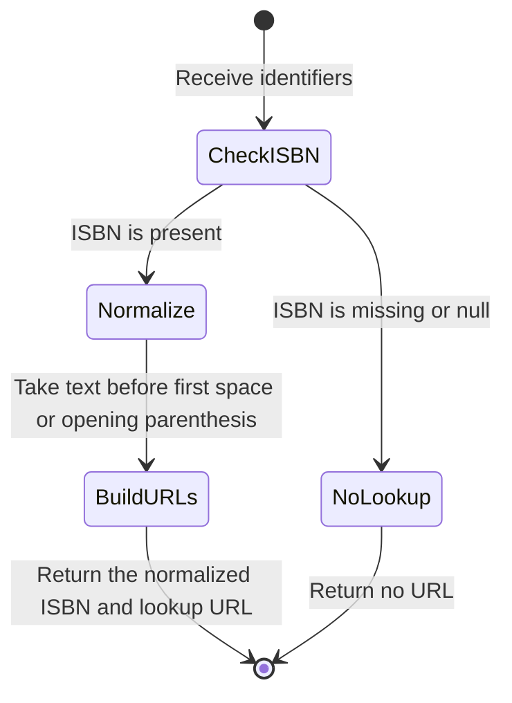
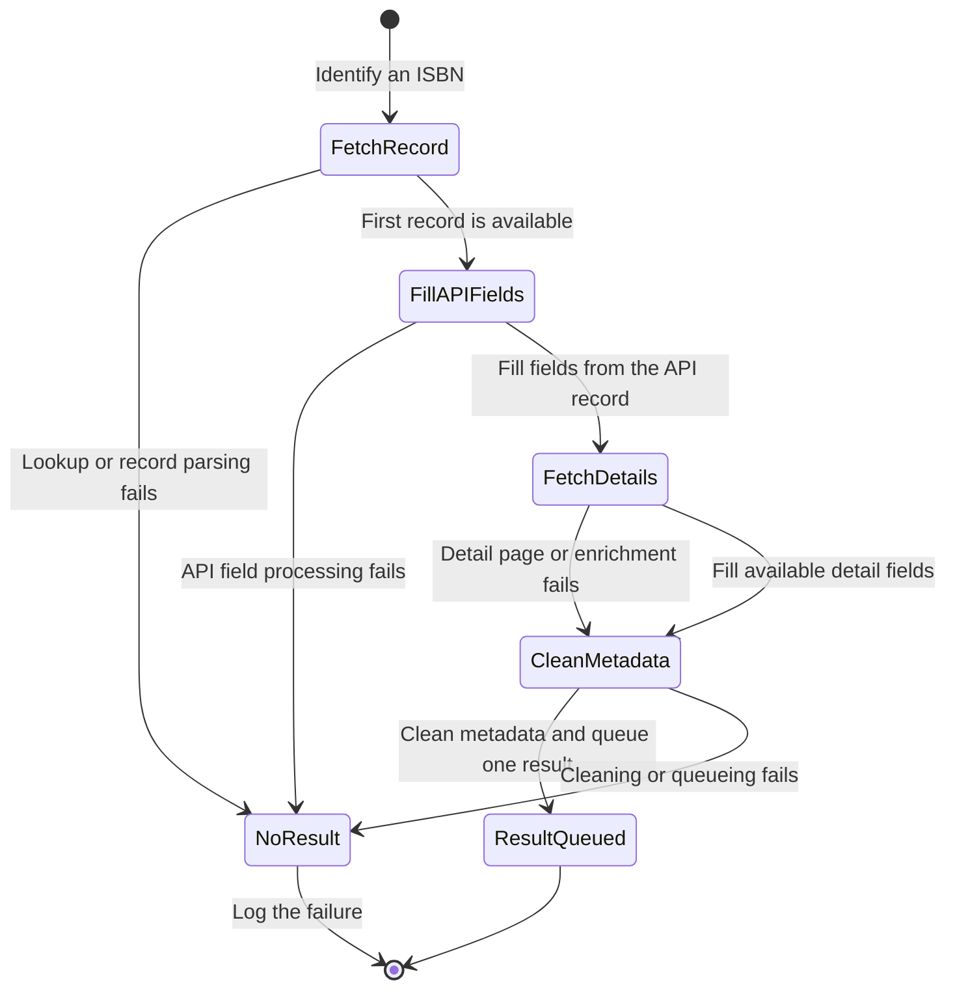
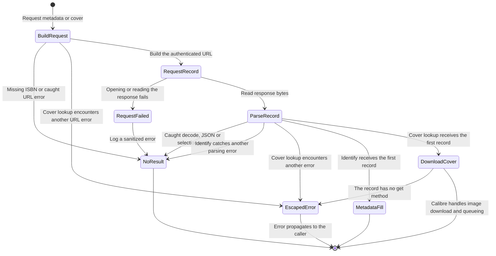

# Korea ISBN Metadata Plugin

This Calibre metadata source retrieves book metadata and cover images by ISBN.
It uses National Library of Korea endpoints.
The implementation is in [Source implementation](__init__.py).

## Requirements and configuration

The source declares plugin version 1.0.0 and a minimum Calibre version of 7.0.0.
It declares Windows, macOS (`osx`) and Linux support.
These are source declarations, not results of executed compatibility tests.

The plugin depends on the Calibre host APIs and imports Beautiful Soup as `bs4`.
It is not a standalone Python application.
There is no standalone Python dependency manifest or installation archive.
The repository has no packaging command.
The root `package.json` manages contributor checks only.

Set the string option `api_key` in Calibre to your National Library API key.
The configuration check reads this option.
The API query sends its value as `cert_key`.
Do not commit or publish your key.

Provide an `isbn` book identifier before requesting metadata or a cover.
The lookup URL builders require this identifier.
Title and author arguments do not provide a fallback search.

## Declared behavior

- The `identify` capability reads the first record from the ISBN API response.
- The `cover` capability downloads the image referenced by that record's `TITLE_URL`.
- Metadata uses the title, authors, publisher and date supplied by the response.
- Metadata also uses supplied series and ISBN fields.
- The book detail page can supply tags, DOI, language and HTML comments.

The API endpoint used by the source is `https://www.nl.go.kr/seoji/SearchApi.do`.
The detail page endpoint is `https://nl.go.kr/seoji/contents/S80100000000.do`.
Endpoint availability and successful authentication remain unverified.

## Repository files

| File | Purpose |
| :--- | :--- |
| [Source implementation](__init__.py) | Calibre metadata source implementation. |
| [plugin-import-name-Korea ISBN Metadata Plugin.txt](<plugin-import-name-Korea ISBN Metadata Plugin.txt>) | Empty plugin import marker with its exact filename. |
| [AGENTS.md](AGENTS.md) | Repository agent entry point. |
| [CONTRIBUTING.md](CONTRIBUTING.md) | Canonical contribution rules and validation guidance. |
| [.github/ISSUE_TEMPLATE](.github/ISSUE_TEMPLATE) | Bug report and improvement templates. |
| [.github/pull_request_template.md](.github/pull_request_template.md) | Pull request evidence template. |

## Lookup state machines

The diagrams describe the plugin's current behavior, including failure paths.
The contributor checks generate inputs for the production methods.
They substitute Calibre and network boundaries.
They do not establish live service or Calibre host behavior.

### ISBN normalization



An empty ISBN remains present and produces an empty query value.
The generated property checks the prefix in both URL builders.
It includes ISBNs with space and parenthesis suffixes.
The plugin does not validate ISBN checksums or encode query values in this step.

### Metadata lookup and fill



A detail-page failure does not discard fields from a usable API record.
The generated property checks that the callback queues cleaned API metadata.
It covers exceptions raised by the detail lookup boundary.
A malformed date or detail field can fail without stopping other fill steps.

### Authenticated request and cover lookup



Each callback makes at most one authenticated metadata request.
A missing ISBN stops it before the request.
The plugin does not retry the request.
On a transport error it replaces the exception before the callback logs it.
The generated property checks both callbacks at the open and read boundaries.
It checks for one request, no queued result and no key in the log.
Calibre owns the subsequent image download.

## Contributor checks

Use Node.js 26 and the pnpm version declared in `package.json`.
Use Python 3 that supports the plugin's syntax.
Run these commands from the repository root.

```sh
pnpm install --frozen-lockfile
pnpm run check
```

Installation runs `prepare` to activate the Husky Git hooks.
See [CONTRIBUTING.md](CONTRIBUTING.md) for check and hook details.

## Validation limits

Contributor checks do not establish Calibre host compatibility or live service behavior.
See [CONTRIBUTING.md](CONTRIBUTING.md#checks) for coverage limits.

## Reporting problems

Use the repository's bug report or improvement template.
Follow [CONTRIBUTING.md](CONTRIBUTING.md) when sharing evidence.
